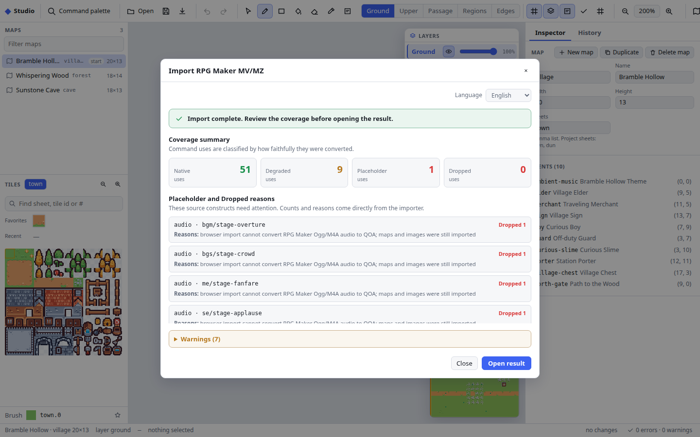
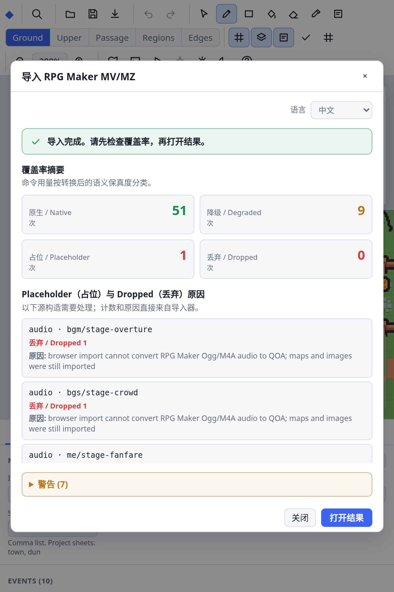

# Importing RPG Maker MV/MZ projects

`tools/rpgmaker-import` converts RPG Maker MV or MZ maps, events, database
records, referenced images and Ogg/M4A media into an `rpgkit-project/v1`
project, generated art, QOA audio and an opt-in front-view battle database.
Plain projects and standard encrypted deployments are supported. The importer
is a build-time tool, so applications which do not use it bundle none of its
code.

This is a compatibility importer, not an RPG Maker JavaScript runtime. Every
import writes a coverage report which separates exact mappings from documented
degradations, visible placeholders and dropped constructs.

## Quick start

### Command line

The source directory must contain `data/System.json`; an MV deployment with
`www/data/System.json` is accepted too. `ffmpeg` must be on `PATH` when the
project references audio. This repository includes a small fixture for a
complete smoke import:

```sh
rm -rf build/rpgmaker-import
bun tools/rpgmaker-import tests/fixtures/rpgmaker/hollow-mz \
  --out build/rpgmaker-import --shard
```

Replace the source and output paths for a real project. The full syntax is
`bun tools/rpgmaker-import <project-dir> --out <dir> [--shard]
[--placeholders visible|silent]`. The destination must not already contain
files from an older import. `--placeholders silent` omits visible text boxes
for unsupported Script/plugin commands while still counting them as
Placeholder. Repeating an import from the same input writes the same bytes.

The CLI and desktop helper write the complete directory:

| Output | Contents |
| --- | --- |
| `project.json`, optionally `maps/*.json` | Inline `rpgkit-project/v1`, or a `ProjectShell` and map shards with `--shard`. |
| `tiles/`, `sprites/`, `animations/`, `parallaxes/`, `pictures/`, `system/` | Generated tile sheets, character blocks, MV animation sheets, backgrounds, pictures and balloons. |
| `audio/*.qoa` | Referenced BGM/BGS/ME/SE, normalized to signed 16-bit stereo at 44.1 kHz and encoded deterministically. |
| `assets.json` | Asset-cooker manifest for sheets, sprites, animation, backgrounds, pictures, audio and animated tiles. |
| `battle.json` | Normalized actors, classes, enemies, troops, skills, items, states, terms, audio settings and map encounters. |
| `audio-media.json` | Per-track source/output sizes, decoded format/duration, or a missing/corrupt reason. |
| `coverage.md`, `coverage.json` | Human and machine-readable handling by source construct. Markdown also includes the static command catalogue and required screen registrations. |

### Studio

Web and desktop Studio expose **Open → Import RPG Maker MV/MZ…** in English
and Chinese. The source is converted without replacing the current document;
Studio shows command-use totals and every Placeholder/Dropped reason first.
Only **Open result** replaces the document. A cancelled or failed import keeps
the current document.

| Browser Studio | Desktop Studio |
| --- | --- |
| Chrome and Edge request read-only folder access. Conversion stays in the page. The resulting pack contains the project shell, map entries and imported PNG assets. The review coverage is not stored in that pack; audio is reported Dropped because a page has no ffmpeg/QOA host, and the pack does not carry `battle.json` or the CLI manifests. Studio play-test uses its generic battle stand-in. Use CLI/desktop when the complete battle/audio output is required. | Native dialogs select the source and destination parent. A helper runs the complete importer, including audio, into a hidden sibling staging directory. It refuses an existing destination and publishes a completed import with one rename. See [Studio desktop](studio-desktop.md#rpg-maker-import). |

The checked-in wide result is English at a 1440 × 900 CSS viewport and device
scale 1; the compact result is Chinese at 600 × 900 and device scale 2. The
compact dialog uses two metric columns without horizontal clipping.

| Wide result | Compact result |
| --- | --- |
|  |  |

### Run the imported result

`project.json` uses the normal engine, but a game still needs to cook the
generated art and explicitly register optional runtime/presentation modules.
The complete reference integration is `tests/fixtures/rmi-play`:

```sh
bun tools/build-example.ts rmi-play
```

Its cooker imports both test projects, bakes map chunks and sprite frames,
packs QOA, pictures, parallaxes, balloons and animations, and writes
`GameAssets`. Its entry registers audio, parallax, item icons, RPG Maker text
and screen presentation, the generated battle database and front-view scene,
formation, travel and name input. See [Optional capabilities](capabilities.md)
for the registrations and their absence behavior.

## Support matrix

The static catalogue runs a minimal sample of each independent/head command
through the real converter. It contains **107 commands**: **95 Native, 9
Degraded, 2 Placeholder and 1 Dropped**. Continuation and branch-marker codes
such as text lines and battle-result branches are handled with their parent
but are not separate catalogue rows.

- **Native**: represented by kit commands without gameplay loss; exact
  importer lowerings also count here.
- **Degraded**: runs with the reason shown below.
- **Placeholder**: emits a deliberate visible stand-in by default.
- **Dropped**: emits no command.

| Handling | Command codes and reason |
| --- | --- |
| Native | The 95 rows marked Native in the [full command table](#full-command-table). Code 355 is Native only for its minimal safe `requestRefresh()` sample; each real Script block is classified separately. |
| Degraded | **132, 133, 139** retain battle BGM/victory/defeat settings, but the current battle presentation does not play them; **137** reorders followers/battle slots but keeps the walking leader art fixed; **138** retains window tone but projects RGB to the kit palette; **223** retains exact tone state with approximate rendering; **283** retains battleback names without painting them; **322** retains actor-image data without updating live map/face/side-view art; **337** retains a numeric animation id without a cooked animation id. |
| Placeholder | **356, 357** (MV/MZ plugin commands) need a per-plugin port. |
| Dropped | **261** (Play Movie) has no video host. |

Recalculate the catalogue from the current converter:

```sh
bun -e 'import { staticCommandTable } from "./tools/rpgmaker-import/report.ts"; const rows=staticCommandTable(); for (const d of ["Native","Degraded","Placeholder","Dropped"]) { const selected=rows.filter((row)=>row.disposition===d); console.log(`${d} ${selected.length} ${selected.map((row)=>row.code).join(",")}`); }'
```

The two self-authored fixtures count real command uses rather than catalogue
rows:

| Fixture | Uses | Native | Degraded | Placeholder | Dropped | Native share |
| --- | ---: | ---: | ---: | ---: | ---: | ---: |
| Hollow MZ | 124 | 112 | 10 | 2 | 0 | 90.3% |
| Stage MV | 61 | 51 | 9 | 1 | 0 | 83.6% |
| Combined | 185 | 163 | 19 | 3 | 0 | 88.1% |

Every real import writes per-project counts to `coverage.md` and
`coverage.json`; those counts, not the static minimal samples, determine the
work needed for that game.

## Battle system

The importer always writes `battle.json`, but battle execution and
presentation are optional application capabilities. A production game imports
`pocket-rpgkit/rpgmaker-battle` and `pocket-rpgkit/ui/rpgmaker-battle`, then
passes the generated database to `GameView`'s `extensions`, `battle` and
`battleScene` props. A `battle` command without registered rules is rejected
when the session loads; `GameView` also requires rules and scene together.

The database normalizes actors/classes, parameter curves, enemies and action
patterns, troops/pages, skills, items, states, terms, rewards, battle audio
settings, battlebacks and map encounters. Battle Processing supports fixed or
variable troops and random encounters, including Win/Escape/Lose branches.
Map encounters feed the same reducer through a deterministic, saved step
counter; Encounter Half and vehicle rates are honored.

Troop pages execute messages, switches and constant variable writes; enemy
HP/MP/TP/state changes, recovery, appear and transform; animation records,
forced actions and abort. Unsupported troop commands are explicitly counted
Dropped. Wins grant deterministic experience, levels, gold and drops. A loss
which RPG Maker does not allow follows Game Over.

Damage formulas are parsed into a bounded data tree and never evaluated as
JavaScript. The subset accepts `a`/`b` battler parameters, literal `v[n]`,
arithmetic, comparisons, boolean operators, ternaries and allowlisted `Math`
members. A rejected formula is reported Degraded and uses
`Math.max(0, a.atk * 4 - b.def * 2)`.

The current module is deterministic front-view battle. Side-view projects are
shown in front view; battle audio settings and battleback names persist but are
not presented; numeric battle-animation ids need cooked art; and the trait
subset is listed under [known limitations](#known-limitations).

## Import-time safe Script subset

RPG Maker stores Script fields as JavaScript. The importer **never executes
that source**. It joins a 355 command and its 655 continuations, then accepts
only a bounded tokenizer/AST allowlist: at most **2,048 source characters, 512
tokens, 512 AST nodes, depth 64, 32 statements, database id 9,999 and string
length 4,096**. Every statement must lower successfully; one unknown or unsafe
shape rejects the entire block, so a safe prefix never runs by accident.

| Accepted shape | Import result and limits |
| --- | --- |
| `$gameMap.requestRefresh()` | Native no-op: kit pages already re-evaluate from live state. |
| `$gameVariables.setValue`, `$gameSwitches.setValue`, `$gameSelfSwitches.setValue` | Literal valid ids and allowlisted values lower to variable/switch commands; multiple self-switch letters are Degraded. |
| `$gameParty.gainItem/loseItem`, `gainGold/loseGold` | Literal database references plus safe numeric amounts lower to inventory/gold commands; stock cap/equipment differences are Degraded. |
| `$gamePlayer.locate`, `reserveTransfer` | Representable transfers are Native; `locate` is Degraded because stock camera/follower/vehicle/encounter side effects differ. |
| `$gameMap.event(id).setPosition/setDirection` | Literal event targets lower to placement/movement; direction-fix and stop-count differences are Degraded. |
| `AudioManager.playSe/playBgm` | A literal object may contain only `name`, `volume`, `pitch` and `pan`. |
| `$gameMessage.add(string)` | A bounded string literal becomes message text. |
| Exact variable/item-count/direction/Steps comparisons and switch/item tests | Representable integer tests lower natively; equipment inclusion is Degraded and player x/y remains Placeholder. |

Numeric expressions reuse the safe formula AST: finite literals,
`$gameVariables.value(id)`, arithmetic and selected `Math` constants/functions.
Constant expressions fold during import. Prototype access, `constructor`,
`globalThis`, `require`, dynamic import, declarations/control flow, unknown
calls and over-budget input fail closed.

Coverage reasons contain source-free shape names. With visible placeholders,
the in-game stand-in includes at most the first 40 normalized source
characters; use `--placeholders silent` when even that preview should be
omitted.

## Known limitations

- Plugins and JavaScript outside the exact safe subset are not ported.
  `js/plugins.js` parameters are not interpreted.
- Browser Studio produces an editable maps/images pack, not the complete
  CLI/desktop directory. It drops audio and does not persist `battle.json`,
  manifests or coverage files in the pack.
- RPG Maker battle is partial front-view battle. Battle audio/battlebacks,
  side-view layout, some traits and uncooked numeric animations are retained
  as data or reported, not fully presented.
- Tone, window colour, MZ cursor/font controls and some animation blend/flash
  behavior are portable approximations. MZ Effekseer animations are dropped.
- Actor event simulation does not cover every later predicate/presentation
  effect. In particular, changed actor art is not drawn live and some actor
  conditions still use imported initial facts.
- Maps larger than **256 × 256** are rejected. Ladder, bush and counter special
  behavior is not simulated; their passage remains.
- RTP and third-party assets retain their own licenses. The importer reads the
  supplied project and does not fetch or grant redistribution rights.
- Missing/corrupt audio is omitted with a reason. Standard RPG Maker encrypted
  media is supported only when `System.json` supplies a valid key/header.

More edge cases are documented in [detailed limitations](#detailed-limitations).

## Real-project trials

Three public games are tested at pinned revisions without committing their
content. Counts are source command uses, **not a fidelity score**:

| Project | Engine and pinned source | Uses | Native | Degraded | Placeholder | Dropped |
| --- | --- | ---: | ---: | ---: | ---: | ---: |
| GameDev: The Beginning | MV 1.6.2, [`a3c3ec7`](https://github.com/yancharkin/game_jams/tree/a3c3ec739071ca285045025f9b619d17877a7193/%5Bigmc_2017%5D_gamedev_the_beginning) | 1,718 | 1,395 | 106 | 161 | 56 |
| The Basement | MV 1.5.2, [`0aea825`](https://github.com/fluxrider/The_Basement/tree/0aea82564bf84299441c6b285e04977f5f11a68a) | 31 | 20 | 11 | 0 | 0 |
| Strange Sea: Before | MZ 1.0.0, [`103d87c`](https://github.com/ShrLeeKNsword/strange_sea_before/tree/103d87c00c8903db841b9aad23dea30e26d6b1a8/ver_0.0.1) | 197 | 151 | 46 | 0 | 0 |
| **Combined** |  | **1,946** | **1,566** | **163** | **161** | **56** |

The combined Native source frequency is **80.5%**. GameDev reaches battle,
but its plugin/Script/picture-heavy opening is not a faithful port. The
Basement and Strange Sea maps, dialogue and front-view battles are
recognizable and playable within the limits above. Each trial's two import
passes produced identical coverage bytes.

## Detailed conversion notes

Mappings are checked against the official MV core at commit
[`182e3144`](https://github.com/rpgtkoolmv/corescript/tree/182e31449707ba7e406db0485c44c2a9d11e2dcd),
including scrolling text, actor predicates, audio commands/ME lifecycle,
formation/window tone, screen tone/weather interpolation and Change Tileset.
The public MZ v1.1.0 mirror at
[`5ecc09ae`](https://github.com/stak/rmmz-corescript/tree/5ecc09ae5170c6aee71c7d9513e553e3dbea116b)
is a corroborating source, not an official repository.

## Ids

| RPG Maker | Kit |
| --- | --- |
| Map 1 | map `map001` |
| Event 7 | event `ev007` on its map |
| Common event 2 | common event `ce002` |
| Switch 1, variable 1 | switch `s001`, variable `v001` |
| Item / weapon / armor 1 | items `item001`, `weapon001`, `armor001` (one bank) |
| Actor 3 / party membership | actor `actor003` with `databaseId: 3`; switch `party-actor003` (stored inverted as `party-out-actor003` for actors in the starting party) |
| Tileset 1 | tile sheet `ts1` |

## Tiles and autotiles

The kit draws one ground tile and one optional "star" tile (above
characters) per cell, from 16 px sheets. RPG Maker stacks four tile layers,
a shadow layer and a region layer per cell, and draws autotiles from
quarter-tile pieces. The importer therefore composes every cell at import
time:

1. The four layers are split by the tileset's star flag (`0x10`): non-star
   tiles, bottom to top with the shadow drawn after layers 0–1 as MV does,
   form the ground cell; star tiles form the upper cell.
2. Each tile is drawn exactly like MV/MZ's `Tilemap`: A5 and B–E tiles are
   plain cuts; autotiles (A1–A4) pick four quarter pieces from their source
   block through the floor (47 shapes + the isolated preview), wall/roof
   (16 shapes) or waterfall (4 shapes) table, with the A1 water and A2
   table-tile special cases.
3. Each distinct stack becomes one cell of the generated sheet. Cells are
   keyed by tile ids, not pixels, so two stacks that look the same but pass
   differently stay separate.
4. Passage follows `Game_Map.checkPassage`: per direction, the top non-star
   tile decides (bit clear = passable); a cell with no deciding tile blocks.
   The four direction bits become the sheet's undirected `dirBlock` edges
   (MV checks the source cell's bit and the destination cell's reverse bit,
   which is exactly `dirBlock`); all four blocked becomes a `block` cell.
5. Animated autotiles (A1 water: steps 0, 1, 2, 1 every 0.5 s; waterfalls:
   three steps) produce one cell per step of the whole stack; the manifest
   lists them per map and the cooker turns them into animated tile sprites.
6. Projects whose tiles are larger than 16 px (MV is always 48 px; MZ stores
   `tileSize`) are composed at their own size and averaged down by an
   integer factor.

The editor stores each autotile's shape in the map data, so the runtime
never computes it. `reshapeAutotiles` reproduces the editor's rule (eight
neighbours, the map edge counts as joined) for hand-written maps such as the
test projects.

Change Tileset references are discovered in map, common-event and troop-event
lists. For every referenced map/tileset pair, the importer precomposes the
ground, upper, passage, vehicle-passage, terrain and animated-cell variants.
The reducer selects the complete variant atomically. In a connected world the
selection is scoped to the active map, so visible neighbours keep their own
art. A transfer clears the visit-local selection and uses the destination's
authored tileset. A tile-image event keeps its page and reducer state, while a
render-only lookup selects the cell cut from the active tileset. Thus changing
the tileset repaints both the map and those events; switching back restores the
original pixels.

## Events

See the [full command table](#full-command-table) for every catalogue code.
In short:

- Pages keep their order; the kit, like MV, runs the highest-numbered page
  whose conditions hold. RPG Maker Event Touch maps to `eventTouch`.
  Non-blocking Player Touch maps to `playerTouch`; blocking Player Touch
  maps to `eventTouch` so walking into the event still starts it, with the
  documented caveat that a moving event can also initiate that contact.
- Conditions on switches, variables (≥), self switches, items and party
  members map directly. Actor name uses the live saved name. Actor class,
  skill, weapon, armour and state tests execute against imported initial
  database facts and are reported Degraded because later actor mutations are
  not modelled.
- Control Variables can read Game Data → Other → Steps. Conditional Branch
  Script can also lower exact comparisons over variables, inventory counts,
  player direction and Steps, plus exact switch and item-presence tests.
  Player-coordinate comparisons are recognized but remain Placeholder because
  the event condition vocabulary has no live-coordinate predicate.
- Commands map to kit commands where one exists; where the kit has a
  narrower command the importer lowers it (for example a comparison
  between two variables goes through a scratch variable; a transfer to a
  map held in a variable becomes a chain of `if` branches over the map
  ids).
- Plugin commands (356, 357) remain placeholders. Script (355/655) uses the
  bounded import-time subset above; a block outside that subset becomes a
  visible text box (or nothing with `--placeholders silent`) and is counted
  as Placeholder.
- Battle Processing becomes the kit's `battle` command with
  `{ troop, name, canEscape, canLose }`, a hash binding it to `battle.json`,
  and real If Win / If Escape / If Lose branches. Fixed troops, variable troop
  ids and random map encounters all resolve through the opt-in module. A win
  grants deterministic experience, levels, gold and drops; a disallowed loss
  follows the ordinary Game Over path.

## Screen and system commands

- **Tint Screen (223)** retains signed red/green/blue and gray channels and
  uses the fixed reference clock for the authored duration and optional wait.
  The state, including an in-progress tween, survives save/load and rewind and
  paints on maps and battles below numbered pictures and battle windows.
  PocketJS does not expose a portable colour-matrix primitive, so the renderer
  uses a deterministic source-over approximation: gray first, complementary
  darkening second, positive-channel brightening last. The exact authored
  descriptor remains in reducer state and saves.
- **Set Weather Effect (236)** supports rain, storm and snow, power 1–9,
  duration and wait. It draws `floor(power * 10)` stock-shaped particles and
  the stock dimmer, with a serialized seed and clock replacing upstream's
  ambient random calls. The result is identical after save/load, rewind and
  at 60/30/20 Hz. Existing weather remains visible when a battle opens.
- **Change Tileset (282)** selects the precomposed variant described above,
  changing ground, upper layer, passage, vehicle passage, terrain and animated
  cells together. Tile-image events resolve their art against that same active
  tileset. The active visit is saved and rewound.
- **Change Window Color (138)** accepts the editor's three-channel RGB tone
  (and four-channel data from compatible tools), defaulting an omitted gray
  channel to zero. Like RPG Maker, presentation consumes RGB only; the kit
  projects those channels onto its theme's message, choice, menu and
  battle-window chrome. A supplied gray channel remains serialized for
  lossless round-tripping. This palette projection
  is reported Degraded because it is not a per-pixel windowskin tone.
- **Change Formation Access (137)** gates the optional formation overlay.
  Its two-confirm flow swaps any pair, including index 0, and the order drives
  followers and front-view battle slots. The saved order is reconciled with
  the current party before every swap. The map player's walking artwork stays
  fixed because `GameView` has one project-level player sprite, so this command
  is reported Degraded.

When a registered RPG Maker battle really opens, the kit applies the pinned
`Game_Screen.onBattleStart` boundary: active fade, flash and shake are cleared,
while tone and weather survive and continue on the stock battle clock. This is
the exact clear list in
[MV `Game_Screen.js:25-31`](https://github.com/rpgtkoolmv/corescript/blob/182e31449707ba7e406db0485c44c2a9d11e2dcd/js/rpg_objects/Game_Screen.js#L25-L31)
and
[MZ `rmmz_objects.js:782-788`](https://github.com/stak/rmmz-corescript/blob/5ecc09ae5170c6aee71c7d9513e553e3dbea116b/rmmz_objects.js#L782-L788).
Stock also clears its zoom bank and stale battle-picture bank. The kit has
neither: `camera` is map-owned rather than RPG Maker zoom, and numbered
pictures use one live map bank, so both remain intact. A battle reducer that
declines entry by returning `null` does not run this boundary. Projects that do
not register the RPG Maker runtime retain the existing kit-native battle
behavior byte-for-byte.

<a id="full-command-table"></a>

## Full command table

Each independent/head MV/MZ event command code and what the importer does with
a minimal use of it: 95 of the 107 commands map natively, 9 run degraded, 2
become placeholders and 1 is dropped. Script's minimal entry is the exact
native refresh no-op above; other shapes are classified per use. "Needs kit"
names the remaining or presentation-only runtime capability. The static table
sends troop-only commands through the same troop converter as a real import,
rather than treating them as map commands.
`tests/rpgmaker-import.test.ts` keeps this table in step with the
importer. Each import also writes the same table, plus per-construct counts
for that project, to `coverage.md`.

<!-- rpgmaker-commands:begin -->
| Code | Command | Flavor | Handling | Notes | Needs kit |
|---:|---|---|---|---|---|
| 101 | Show Text | MV/MZ | Native |  | face graphics per message (portrait keyed by file/index, not speaker); inline icons, timing/gold-window controls and MZ \PX/\PY/\FS presentation |
| 102 | Show Choices | MV/MZ | Native |  | single-option lists and a default cursor row |
| 103 | Input Number | MV/MZ | Native |  |  |
| 104 | Select Item | MV/MZ | Native |  |  |
| 105 | Show Scrolling Text | MV/MZ | Native |  |  |
| 108 | Comment | MV/MZ | Native |  |  |
| 109 | Skip | MZ | Native |  |  |
| 111 | Conditional Branch | MV/MZ | Native |  | conditions over actor stats, enemies, event facing and buttons |
| 112 | Loop | MV/MZ | Native |  |  |
| 113 | Break Loop | MV/MZ | Native |  |  |
| 115 | Exit Event Processing | MV/MZ | Native |  | a return-from-common-event command (exit ends the calling fiber) |
| 117 | Common Event | MV/MZ | Native |  |  |
| 118 | Label | MV/MZ | Native |  |  |
| 119 | Jump to Label | MV/MZ | Native |  |  |
| 121 | Control Switches | MV/MZ | Native |  |  |
| 122 | Control Variables | MV/MZ | Native |  | variable sources for actor, character, party and remaining game data |
| 123 | Control Self Switch | MV/MZ | Native |  | four independent self switches per event (the kit keeps one slot) |
| 124 | Control Timer | MV/MZ | Native |  | the screenPresentation capability |
| 125 | Change Gold | MV/MZ | Native |  | gold changes by variable and a 0 floor on losses |
| 126 | Change Items | MV/MZ | Native |  | item changes by variable and a 0 floor on losses |
| 127 | Change Weapons | MV/MZ | Native |  | equipment (equipped copies) and item changes by variable |
| 128 | Change Armors | MV/MZ | Native |  | equipment (equipped copies) and item changes by variable |
| 129 | Change Party Member | MV/MZ | Native |  | a party roster (the importer keeps one switch per actor) |
| 132 | Change Battle BGM | MV/MZ | Degraded | battle BGM setting persists, but the current battle audio lifecycle does not play it | battle audio settings in the battle setup |
| 133 | Change Victory ME | MV/MZ | Degraded | victory ME setting persists, but the current battle audio lifecycle does not play it | battle audio settings in the battle setup |
| 134 | Change Save Access | MV/MZ | Native |  |  |
| 135 | Change Menu Access | MV/MZ | Native |  |  |
| 136 | Change Encounter | MV/MZ | Native |  | random encounters |
| 137 | Change Formation Access | MV/MZ | Degraded | formation reorders followers and battle slots but keeps the walking leader fixed |  |
| 138 | Change Window Color | MV/MZ | Degraded | window tone is retained exactly and projected onto the kit theme palette |  |
| 139 | Change Defeat ME | MV/MZ | Degraded | defeat ME setting persists, but the current battle audio lifecycle does not play it | battle audio settings in the battle setup |
| 140 | Change Vehicle BGM | MV/MZ | Native |  |  |
| 201 | Transfer Player | MV/MZ | Native |  | a white transfer fade colour |
| 202 | Set Vehicle Location | MV/MZ | Native |  |  |
| 203 | Set Event Location | MV/MZ | Native |  | place by variable coordinates and character exchange |
| 204 | Scroll Map | MV/MZ | Native |  |  |
| 205 | Set Movement Route | MV/MZ | Native |  | diagonal, jump, backward/away moves, relative turns, in-route switches/SE/image |
| 206 | Get on/off Vehicle | MV/MZ | Native |  |  |
| 211 | Change Transparency | MV/MZ | Native |  |  |
| 212 | Show Animation | MV/MZ | Native |  |  |
| 213 | Show Balloon Icon | MV/MZ | Native |  |  |
| 214 | Erase Event | MV/MZ | Native |  |  |
| 216 | Change Player Followers | MV/MZ | Native |  |  |
| 217 | Gather Followers | MV/MZ | Native |  |  |
| 221 | Fadeout Screen | MV/MZ | Native |  |  |
| 222 | Fadein Screen | MV/MZ | Native |  |  |
| 223 | Tint Screen | MV/MZ | Degraded | signed tone is retained exactly; portable rendering approximates additive colour and desaturation | the rpgMakerText runtime and screenPresentation capability |
| 224 | Flash Screen | MV/MZ | Native |  |  |
| 225 | Shake Screen | MV/MZ | Native |  |  |
| 230 | Wait | MV/MZ | Native |  |  |
| 231 | Show Picture | MV/MZ | Native |  | the screenPresentation capability |
| 232 | Move Picture | MV/MZ | Native |  | the screenPresentation capability |
| 233 | Rotate Picture | MV/MZ | Native |  | the screenPresentation capability |
| 234 | Tint Picture | MV/MZ | Native |  | the screenPresentation capability |
| 235 | Erase Picture | MV/MZ | Native |  | the screenPresentation capability |
| 236 | Set Weather Effect | MV/MZ | Native |  | the rpgMakerText runtime and screenPresentation capability |
| 241 | Play BGM | MV/MZ | Native |  |  |
| 242 | Fadeout BGM | MV/MZ | Native |  |  |
| 243 | Save BGM | MV/MZ | Native |  |  |
| 244 | Resume BGM | MV/MZ | Native |  |  |
| 245 | Play BGS | MV/MZ | Native |  |  |
| 246 | Fadeout BGS | MV/MZ | Native |  |  |
| 249 | Play ME | MV/MZ | Native |  |  |
| 250 | Play SE | MV/MZ | Native |  |  |
| 251 | Stop SE | MV/MZ | Native |  |  |
| 261 | Play Movie | MV/MZ | Dropped |  | video playback |
| 281 | Change Map Name Display | MV/MZ | Native |  | the screenPresentation capability |
| 282 | Change Tileset | MV/MZ | Native |  |  |
| 283 | Change Battle Background | MV/MZ | Degraded | battle background names persist, but battle backgrounds are not presented | battle backgrounds in the battle setup |
| 284 | Change Parallax | MV/MZ | Native |  |  |
| 285 | Get Location Info | MV/MZ | Native |  |  |
| 301 | Battle Processing | MV/MZ | Native |  |  |
| 302 | Shop Processing | MV/MZ | Native |  |  |
| 303 | Name Input Processing | MV/MZ | Native |  |  |
| 311 | Change HP | MV/MZ | Native |  | actor stats |
| 312 | Change MP | MV/MZ | Native |  | actor stats |
| 326 | Change TP | MV/MZ | Native |  | actor stats |
| 313 | Change State | MV/MZ | Native |  | actor states |
| 314 | Recover All | MV/MZ | Native |  | actor stats |
| 315 | Change EXP | MV/MZ | Native |  | actor experience |
| 316 | Change Level | MV/MZ | Native |  | actor levels |
| 317 | Change Parameter | MV/MZ | Native |  | actor parameters |
| 318 | Change Skill | MV/MZ | Native |  | actor skills |
| 319 | Change Equipment | MV/MZ | Native |  | equipment slots |
| 320 | Change Name | MV/MZ | Native |  | runtime names for actors other than actor 1 |
| 321 | Change Class | MV/MZ | Native |  | actor classes |
| 322 | Change Actor Images | MV/MZ | Degraded | actor images persist, but map, face, and side-view presentation do not update live | per-actor walking/face/battler images (the player sprite can change via appearance) |
| 323 | Change Vehicle Image | MV/MZ | Native |  |  |
| 324 | Change Nickname | MV/MZ | Native |  | actor profiles |
| 325 | Change Profile | MV/MZ | Native |  | actor profiles |
| 331 | Change Enemy HP | MV/MZ | Native |  | an RPG Maker battle system |
| 332 | Change Enemy MP | MV/MZ | Native |  | an RPG Maker battle system |
| 342 | Change Enemy TP | MV/MZ | Native |  | an RPG Maker battle system |
| 333 | Change Enemy State | MV/MZ | Native |  | an RPG Maker battle system |
| 334 | Enemy Recover All | MV/MZ | Native |  | an RPG Maker battle system |
| 335 | Enemy Appear | MV/MZ | Native |  | an RPG Maker battle system |
| 336 | Enemy Transform | MV/MZ | Native |  | an RPG Maker battle system |
| 337 | Show Battle Animation | MV/MZ | Degraded | battle animation keeps its numeric database id because no cooked animation id is available | an RPG Maker battle system |
| 339 | Force Action | MV/MZ | Native |  | an RPG Maker battle system |
| 340 | Abort Battle | MV/MZ | Native |  | an RPG Maker battle system |
| 351 | Open Menu Screen | MV/MZ | Native |  |  |
| 352 | Open Save Screen | MV/MZ | Native |  |  |
| 353 | Game Over | MV/MZ | Native |  |  |
| 354 | Return to Title Screen | MV/MZ | Native |  |  |
| 355 | Script | MV/MZ | Native |  | hand-porting for JavaScript outside the import-time safe subset |
| 356 | Plugin Command (MV) | MV | Placeholder | plugin command not ported | a per-plugin port (an ext handler) |
| 357 | Plugin Command (MZ) | MZ | Placeholder | plugin command not ported | a per-plugin port (an ext handler) |
<!-- rpgmaker-commands:end -->

Besides the commands, the report counts conditional branch types, page
conditions, triggers, movement route steps, message escape codes and tile
constructs. It also records every referenced audio file's source and encoded
size, decoded duration/format, or the exact missing/corrupt reason. Of note:

- **Touch events that block** (same-as-characters priority) keep blocking
  and use `eventTouch`, so walking into them starts the page without moving
  onto their cell. For a door embedded in an impassable wall, the importer
  opens the underlying terrain edge while the event body remains the
  blocker. Blocking RPG Maker Player Touch is counted Degraded because a
  moving event can also initiate the kit contact; direct Event Touch is
  counted Native. Non-blocking Player Touch remains `playerTouch`.
- **Loops** use the kit's structured `loop` and `break` commands for every
  shape, including a loop that occupies an entire autorun or parallel page.
  The loop back-edge does not re-evaluate page conditions; conditions are
  checked again only after the page program ends and is eligible to start
  anew. A Break Loop outside a parsed loop ends that page or common event
  and is conservatively counted Degraded for malformed flat command lists.
  Label and Jump to Label map natively: a jump goes to the first label with
  that name anywhere in the same page or common event, at any nesting depth,
  entering or leaving branch blocks unconditionally like MV's flat-list
  jumpTo. A jump to a name with no label does nothing. See
  [Loops and labels](../src/engine/README.md#loops-and-labels).
- **Self switches**: the kit keeps one self-switch letter per event, so an
  event that sets B after A loses A (counted Degraded where it happens).
- **Waited movement routes** that change a switch, the character's
  image, opacity or transparency, or play a sound in the middle are split
  at those steps into route, command, route — exact, because the event
  waits for the route anyway. Unwaited or repeating routes drop those
  steps.
- **Escape codes**: message and choice strings retain their source spelling.
  The generated actor catalogue and `system.rpgMakerText` configuration let
  the runtime expand `\N[n]`, `\P[n]`, `\V[n]`, `\G` and `\\`, and apply
  `\C[n]` colour spans when the box opens. Expansion is one left-to-right
  pass; replacement values containing another escape are not rescanned.
  `\P[n]` follows the imported party order. In Show Text, MZ `\PX` and `\PY`
  set a cursor position scaled into the kit's message content box, and `\FS`
  selects the nearest baked font slot. Those three remain Degraded because the
  coordinate/font metrics are an approximation and choice-list layout does not
  consume them. Inline icons, font-size shorthands, timing controls and the
  gold-window control remain byte-for-byte present without a visual effect.
  Unknown/plugin escapes also remain visible instead of being silently
  deleted.
- **Parallaxes**: `parallaxName`, both loop flags, signed `parallaxSx/Sy`,
  editor visibility and the leading-`!` zero-camera convention become the
  map's authored parallax. Change Parallax (284) replaces or clears the same
  state. Source pixels, scroll speeds included, are divided by the map scale
  exactly as tiles are, so a looping axis scrolls at MV's on-screen rate.
  The runtime repeats loop axes, proportionally follows non-loop axes (MV
  pins an ordinary non-looping parallax to the screen; following the map
  keeps parallax-mapped scenes aligned with their events), and clips the
  result to the active map in a connected world. Painting is an
  explicit `GameView parallax={ParallaxLayer}` opt-in from
  `pocket-rpgkit/ui/parallax`.
- **Show Animation (212)**: legacy MV cell animations are composited at
  import time, including every cell's translation, scale, rotation, mirror,
  opacity, hue and blend. The command follows its player/event target and may
  wait. Head, centre and feet positions are measured from a one-tile
  character (MV measures the target sprite, so tall `$` characters sit
  differently); the screen-centre position is dropped with a coverage
  reason. SE and full-screen-flash timing rows are retained. Target-local flash
  and temporary target hiding are omitted; non-normal blending is exact among
  cells in the flattened frame but cannot interact with the map below it.
  MZ Effekseer animation records have no compatible cell timeline and are
  dropped with an explicit coverage reason.
- **Item icons**: a valid 32 px `IconSet.png` becomes a 16 px `iconset` sheet;
  each item, weapon and armour keeps its `iconIndex` as `sprite` when that cell
  exists. The runtime shop draws it only when the game opts into
  `pocket-rpgkit/ui/item-icons`; other games keep the old text-only bundle and
  layout.
- **Audio media**: logical names are matched case-insensitively under
  `audio/{bgm,bgs,me,se}`. Ogg is preferred when both deployment formats are
  present; a corrupt preferred file is reported rather than silently changing
  source. `ffmpeg` decodes the selected stream to stable 44.1 kHz stereo
  signed-16 PCM and the repository QOA encoder writes the final bytes. The
  decoded ME frame count supplies `playMe.duration` at 60 reference ticks per
  second. Volume, pitch and pan (-100..100) are retained on every audio
  command. `ffmpeg` must be on `PATH` while importing.

## Detailed limitations

- **Plugins and arbitrary scripts are not ported.** The exact import-time
  Script subset above lowers without executing source. Everything else in
  Script commands, Script conditions and script variable operands becomes a
  placeholder; plugin commands always do. Plugin parameters in
  `js/plugins.js` are not read.
- **RTP assets.** The RPG Maker runtime package (RTP) art and audio is
  licensed for use in RPG Maker games only. The importer reads whatever
  images a project folder holds and does not ship or fetch any; do not
  redistribute RTP art in a kit game unless your license allows it.
- **Standard encrypted deployment media is supported.** When `System.json`
  enables encrypted images or audio and carries a valid 32-hex-digit key, the
  importer strips the RPG Maker deployment header and decrypts the encrypted
  prefix before decoding PNG/Ogg/M4A bytes. A missing/malformed key, invalid
  header or encrypted suffix that disagrees with `System.json` fails with a
  specific error. This is media decryption only; plugins and arbitrary scripts
  are still not ported.
- **Missing or corrupt audio is omitted.** The reference remains in event
  intent but no `project.audio` entry or QOA file is emitted; `coverage.md`,
  `coverage.json`, `audio-media.json` and the CLI warning carry the reason.
- **RPG Maker battle support is opt-in and partial.** The deterministic
  front-view module imports actor/class parameter curves, enemy action patterns,
  troops and positions, skills/items, states, rewards, weighted region-aware
  map encounters, and the common turn/enemy-HP/switch troop-page conditions.
  Troop pages additionally execute enemy HP/MP/TP/state changes, recovery,
  appear, transform, forced actions and abort in source order. MV side-view
  projects intentionally render in front view. Numeric Show Battle Animation
  ids are retained but cannot paint without a cooked animation id. Battle
  BGM/ME records and per-map battleback names persist, but the current battle
  presentation does not consume them. Encounter Disable works; Encounter Half
  halves progress, ships halve it again, boats keep the walking rate and
  airships freeze the saved countdown. Stock bush doubling is not modelled.
  One targeting edge intentionally differs from stock: MV/MZ can resolve an
  explicitly indexed hidden-but-living troop member because hiding does not
  change `isAlive()`, while the kit redirects that explicit target to the first
  visible eligible member until an Appear command reveals it.
- **Trait execution is intentionally bounded.** The battle reducer consumes
  parameter, element, state, hit/evasion/critical, recovery/cost/damage,
  targeting, attack-element/state/speed/times/skill, added-skill, Guard and
  reward-multiplier traits. Other normalized trait records remain Degraded:
  debuff rates; skill-type add/seal and skill seal; equipment lock and slot
  type changes after import; Action Times+; Auto Battle, Substitute and
  Preserve TP special flags; and collapse types. They stay in `battle.json`
  for a later reducer extension rather than being guessed.
- **Damage formulas use a safe subset, never `eval`.** Battler parameters
  (`a.atk`, `b.def`, and the other basic parameters), literal `v[n]`, arithmetic,
  comparisons, boolean operators, ternaries and common `Math` functions are
  parsed into a bounded JSON tree. A formula outside that subset is reported as
  Degraded and deterministically falls back to
  `Math.max(0, a.atk * 4 - b.def * 2)`.
- **Event-time actor simulation is still incomplete.** Map events can change
  actor HP/MP/TP, states, recovery, EXP, level, parameter bonuses, skills,
  equipment, class, images, nickname and profile; the saved extension state is
  also the next battle's source and rewinds with the session. Show Level Up
  messages and changed actor-image presentation are not drawn. Actor event
  conditions for class, skill, equipment and state still read imported initial
  facts. A `\P[n]` lookup uses the initial party order rather than later Change
  Party Member results.
- **Maps are capped at 256 × 256**, the kit's limit.
- Region ids and terrain tags are carried over as sparse per-cell map data
  (Get Location Info, the `region` condition and authored region-crossing
  pages read them). The opt-in battle module consumes encounter region sets
  and map encounters; damage floors are not modelled. RPG Maker has no stock
  region-enter/leave event trigger for the importer to synthesize. Ladders,
  bushes and counters keep their passage but not their special behaviour.
- Import-time message wrapping protects complete escape spellings but still
  budgets the raw source length, not the final visible pixel width after
  expansion. Runtime pagination then wraps the expanded visible text safely.
- MZ Effekseer animations are not converted. MV target-only flash, temporary
  target hiding and blend interaction with the map are reported as degraded,
  while their remaining animation still imports.
